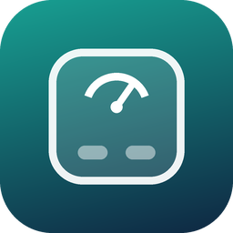
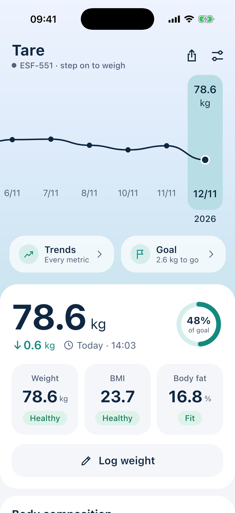
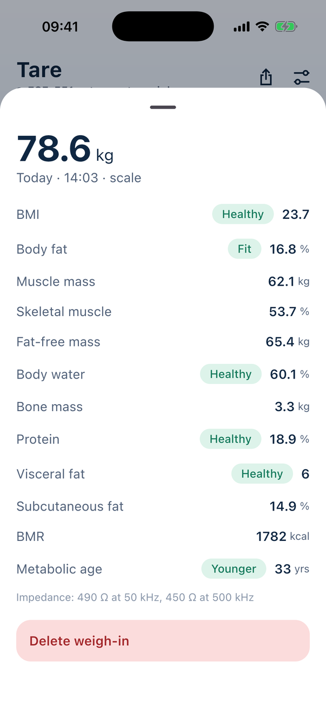
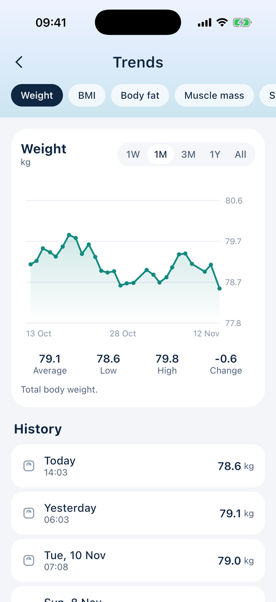
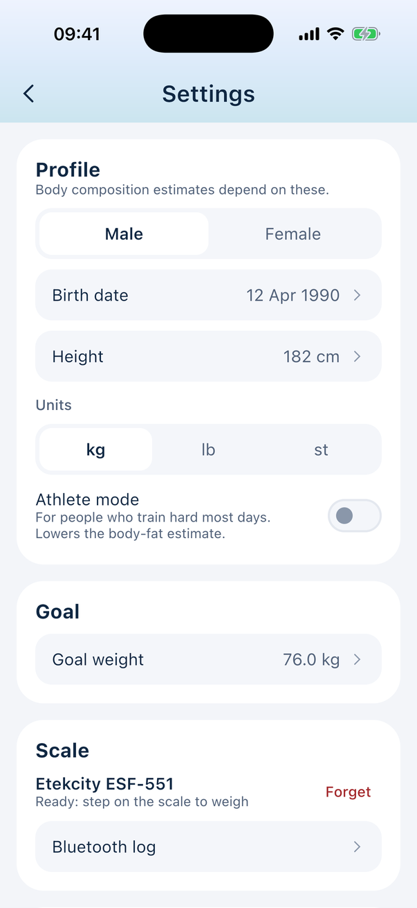
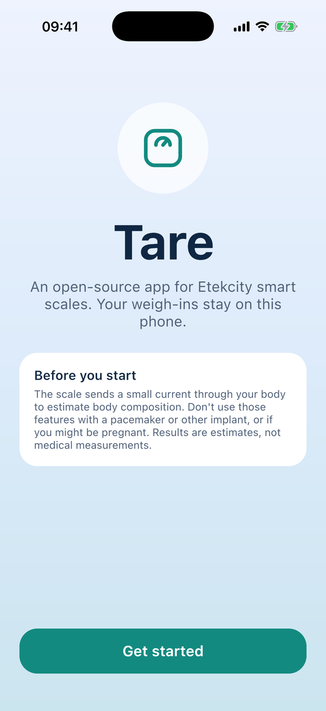
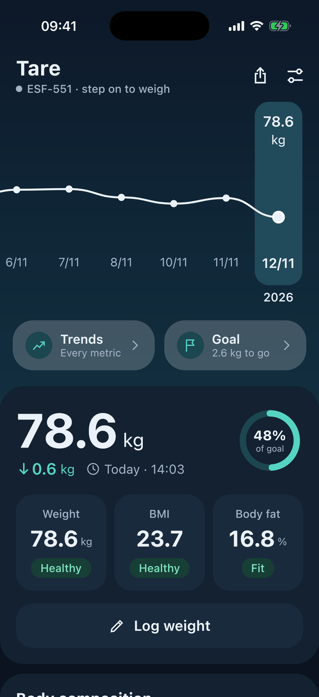

<p align="center">
  
</p>

<h1 align="center">Tare</h1>

<p align="center">
  An open-source iPhone app for Etekcity ESF-24 and ESF-551 Bluetooth scales: weigh-ins,
  body-composition estimates and trends, kept on your phone.
</p>

<p align="center">
  <a href="LICENSE"></a>
  
  
</p>

<p align="center">
  
  
  
  <br>
  
  
  
</p>

<p align="center">
  <sub>iOS Simulator with made-up sample data (<code>-demoData</code>).</sub>
</p>

Step on the scale and the weigh-in appears on your phone, with body-composition estimates,
trends and optional Apple Health sync. There is no account and no server. Tare is written in
Kotlin Multiplatform and Compose Multiplatform; iOS is the only app target so far.

Tare is an independent project. It works with Etekcity scales but is not affiliated with
Etekcity or VeSync.

> **Status: early.** The protocols are tested against frames captured from real scales, but
> the app has been tried on only one real scale so far, an ESF-551. See
> [Supported scales](#supported-scales).

## Features

- **Automatic weigh-ins.** Pair once. Tare then holds a pending Bluetooth connection to the
  scale, which iOS completes when someone steps on it, even with the app in the background.
- **Offline weigh-ins** (ESF-24 family only). Readings the scale stored while your phone was
  away are fetched on the next connection. The scale deletes each one as it sends it, so the
  vendor's app won't see them; you can turn this off in Settings.
- **Body composition.** Besides weight and BMI, Tare shows eleven estimates: body fat, muscle
  mass, skeletal muscle, fat-free mass, body water, bone mass, protein, visceral fat,
  subcutaneous fat, basal metabolic rate (BMR) and metabolic age.
  - The scale measures only weight and electrical impedance. Tare works out the rest from
    your weight, height, age, sex and the 50 kHz impedance, using bioimpedance formulas that
    reproduce the vendor app's algorithm. They are estimates, not clinical measurements.
  - Estimates need bare feet on the electrodes and a profile with height and birth date.
    Athlete mode applies the formulas' variant for people who train hard most days.
  - Coloured labels compare values with general-population reference ranges (WHO bands for
    BMI, American Council on Exercise bands for body fat), not the vendor's.
- **Units.** Kilograms, pounds, or stones and pounds. Tare switches the scale's own display to
  match, except on the kg-only Japanese ESF-551.
- **History and trends.** Chart any metric over a week, a month, three months, a year or all
  time, with the average, low, high and change, and that range's weigh-ins listed below.
- **Goal weight** with a progress ring, measured from your first weigh-in.
- **Manual entries** for weigh-ins on another scale (weight only).
- **Apple Health** (optional). Writes weight, BMI, body fat percentage and lean body mass for
  every weigh-in, including earlier ones when you turn it on. Deleting a weigh-in in Tare
  removes its samples. Tare doesn't read anything from Apple Health.
- **CSV export** of every weigh-in, with impedances and the derived metrics.
- **Bluetooth log** of nearby devices and raw frames, to help add support for other models and
  firmware.
- Light and dark mode, following the system setting.

## Supported scales

| Scale | Protocol | Offline weigh-ins | Tried on a real scale |
|---|---|---|---|
| ESF-24 | QN platform, with a handshake | Yes | Not yet. Decoding is tested against frames captured from real ESF-24s. |
| ESF-17, ESF-18 | Reported to be the same as the ESF-24 | Yes | No |
| ESF-551 | Etekcity platform, streams weight frames | No (the scale has no store) | Yes. Confirmed on 12 Nov 2026: it pairs, and weigh-ins arrive and are written to Apple Health. |
| ESF-551 (Japan) | As the ESF-551, kg only | No | No |

Body-composition estimates need the impedance the scale measures through bare feet. A reading
without it (socks on, or a manual entry) shows weight and BMI only.

Other Etekcity scales, such as the EFS-A591S and EFS-C651, advertise the same name as the
ESF-551 but aren't supported. While pairing, Tare lists devices that might be scales
separately. If yours shows up there or not at all, a [Bluetooth log](#contributing) helps.

## How it works

- **Protocol core** (`core/`). Platform-independent Kotlin with no UI or Bluetooth. It
  recognises scales from their advertisements, decodes and builds frames, and runs a session
  per connection: the ESF-24's handshake (display unit, clock, stored readings) or the
  ESF-551's stream of weight frames. The same module holds the body-composition formulas,
  reference ranges, units, SQLDelight storage and CSV export. It also builds for the JVM, so
  its tests run in seconds. The wire formats are documented in
  [docs/PROTOCOL.md](docs/PROTOCOL.md).
- **Bluetooth** (`composeApp/…/ble/ScaleManager.kt`). [Kable](https://github.com/JuulLabs/kable)
  scans while pairing, then keeps a connection request open to the paired scale. When the scale
  wakes, Tare subscribes to its notify characteristic, feeds each frame to the session, writes
  the session's replies back and saves the readings. The app declares the
  `bluetooth-central` background mode, so this carries on while the app is in the background.
- **Compose UI** (`composeApp/`). Every screen is shared Compose Multiplatform code. A thin
  SwiftUI shell (`iosApp/`) hosts it, and platform specifics (share sheet, Bluetooth state,
  regional formats, files) sit behind `expect` declarations in `tare/platform`.
- **HealthKit bridge.** The Kotlin side defines a `HealthBridge` interface;
  `iosApp/Tare/HealthKitBridge.swift` implements it. Each sample carries a sync identifier
  derived from the weigh-in, so saving again replaces it and deleting a weigh-in finds it.

## Privacy

- Tare has no account, server, analytics or ads, and its code makes no network connections.
- Weigh-ins, your profile and settings are stored in a SQLite database inside the app's
  container. Deleting the app deletes them; samples already written to Apple Health stay there.
- Data leaves the app only when you choose: exporting a CSV, sharing the Bluetooth log, or
  turning on Apple Health.
- The Bluetooth log (`Documents/bluetooth-log.txt`) records nearby devices' names and
  advertisements and the scale's raw frames, which contain your weights. Read it before you
  share it.
- The app's privacy manifest declares no tracking and no collected data.

## Requirements

- An iPhone running iOS 17 or later (iPhone only, portrait).
- A supported scale. For body-composition estimates: bare feet, plus your height, birth date
  and sex in the profile.
- To build: a Mac with Xcode 16.4 or later, JDK 21 and [XcodeGen](https://github.com/yonaskolb/XcodeGen).
  Uploading to TestFlight needs Xcode 26, as App Store Connect accepts only iOS 26 SDK builds.

## Building from source

```sh
brew install openjdk@21 xcodegen
export JAVA_HOME=/opt/homebrew/opt/openjdk@21

git clone https://github.com/wikoion/tare.git
cd tare
./gradlew :core:jvmTest           # protocol, body-composition and storage tests

cd iosApp
xcodegen generate                 # creates Tare.xcodeproj, which isn't committed
open Tare.xcodeproj               # run the Tare scheme
```

A build phase in the Xcode project runs Gradle to compile the shared Kotlin code into a
framework. The first build downloads the Kotlin/Native toolchain and takes a few minutes.

**Simulator.** The simulator has no Bluetooth, so start the app with `-demoData` for sample
history in a separate database (in Xcode: Product › Scheme › Edit Scheme › Run › Arguments).
From the command line, using any simulator from `xcrun simctl list devices`:

```sh
xcodebuild -project iosApp/Tare.xcodeproj -scheme Tare \
  -destination 'platform=iOS Simulator,name=iPhone 16 Pro' \
  -derivedDataPath iosApp/build/DerivedData build
xcrun simctl install booted iosApp/build/DerivedData/Build/Products/Debug-iphonesimulator/Tare.app
xcrun simctl launch booted io.github.tare.Tare -demoData
```

`io.github.tare.Tare` is the default bundle ID; use yours if you set one in `Local.xcconfig`.

**iPhone.** Copy `iosApp/Config/Local.xcconfig.example` to `iosApp/Config/Local.xcconfig`
(it's gitignored), set your team ID and a unique bundle ID, then run from Xcode or
`scripts/install-app.sh`.

**Android** isn't supported yet: `core` builds for the JVM, but the app has no Android target.

[docs/DEVELOPMENT.md](docs/DEVELOPMENT.md) covers the other launch arguments, TestFlight
uploads, the Bluetooth log and how the screenshots are made.

## Project layout

```text
core/                     Kotlin Multiplatform library (JVM + iOS): no UI, no Bluetooth
  src/commonMain/kotlin/tare/
    protocol/             scale detection, ESF-24 and ESF-551 frames and sessions
    body/                 body-composition formulas and reference ranges
    data/                 SQLDelight storage, models, CSV export, demo data
    units/                kg, lb and st conversion and formatting
  src/commonTest/         protocol, body-composition and unit tests
  src/jvmTest/            storage tests
composeApp/               the shared app
  src/commonMain/kotlin/tare/
    ble/                  ScaleManager: scanning, pairing, the connection loop
    health/               HealthSync and the HealthBridge interface
    platform/             expect declarations for platform code
    ui/                   screens, components, charts and theme
  src/iosMain/            iOS implementations and the entry point
iosApp/                   SwiftUI shell, HealthKit bridge, XcodeGen project.yml
scripts/                  install-app.sh (iPhone), testflight.sh (TestFlight upload)
docs/                     PROTOCOL.md, DEVELOPMENT.md, images
```

## Status

Version 0.1.0, early. The app runs on iOS and has been confirmed end to end with an ESF-551
(12 Nov 2026): weigh-ins arrive and are written to Apple Health. The ESF-24 family hasn't been
tried on a real scale yet (see [Supported scales](#supported-scales)). Possible next steps:

- Android: an `androidTarget()` in `composeApp`, Android implementations of `tare/platform`,
  and an app module. Kable, SQLDelight and Compose already support Android.
- Health Connect on Android.
- More than one person per scale, assigned by weight.
- Reading weight history back from Apple Health.
- A home-screen widget.

## Contributing

Issues and pull requests are welcome. The most useful report is a Bluetooth log from a scale
that doesn't appear or misbehaves: Settings › Bluetooth log, then the share button. It
includes your weights and nearby devices' names, so check it first.

For code changes, run `./gradlew :core:jvmTest` and keep to the project's rules:

- The protocol and body-composition code is an independent Kotlin port of the MIT
  [etekcity_esf551_ble](https://github.com/ronnnnnnnnnnnnn/etekcity_esf551_ble) library,
  credited in [THIRD_PARTY_NOTICES.md](THIRD_PARTY_NOTICES.md). Don't paste code from other
  projects; credit protocol facts, formulas and test vectors in the notices.
- Test frames must be real captures or synthetic. Never commit someone's personal readings.
- Don't copy the vendor app's assets or text.

## Licence

MIT. See [LICENSE](LICENSE).

## Acknowledgements

The ESF-24 and ESF-551 protocols and the body-composition formulas come from the
reverse-engineering in [etekcity_esf551_ble](https://github.com/ronnnnnnnnnnnnn/etekcity_esf551_ble)
by Ron Ben Yosef and contributors (MIT), as do the captured frames and vendor-app values Tare
uses as test vectors. Tare's protocol and body-composition code is an independent Kotlin port
of that library.
[THIRD_PARTY_NOTICES.md](THIRD_PARTY_NOTICES.md) has the details and licence text.

Tare is built with [Kotlin](https://kotlinlang.org),
[Compose Multiplatform](https://github.com/JetBrains/compose-multiplatform),
[Kable](https://github.com/JuulLabs/kable) and [SQLDelight](https://github.com/sqldelight/sqldelight).

## Disclaimer

Tare is not a medical device. Its body-composition figures are bioimpedance estimates, not
clinical measurements; don't use them for medical decisions.

The scale passes a small electrical current through your body to measure impedance. Don't use
the body-composition features if you have a pacemaker or other implanted medical device, or
if you might be pregnant. Tare can't switch on the vendor's zero-current or pregnancy modes.

Tare is not affiliated with, endorsed by or connected to Etekcity or VeSync Co., Ltd.
"Etekcity" and "VeSync" are trademarks of their respective owners and appear here only to say
which scales the app works with.
